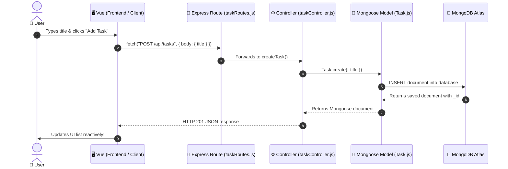

# MEVN Stack - Simple Task CRUD with Dynamic Search Filter

A minimal, beginner-friendly **MEVN** (MongoDB, Express, Vue 3, Node.js) application built with an **MVC (Model-View-Controller)** pattern.

Includes:
- **C**reate: Add tasks
- **R**ead: View all tasks + real-time title search filter
- **U**pdate: Toggle completion checkbox or edit task title
- **D**elete: Remove tasks

---

## 🐣 What is the MEVN Stack? (For Beginners)

| Technology | Role | What it actually does in this app |
| :--- | :--- | :--- |
| **M**ongoDB | **Database** | Stores your tasks as JSON-like documents (persisted in MongoDB Atlas cloud). |
| **E**xpress | **Backend Framework** | Handles routing, receives HTTP requests (`GET`, `POST`, etc.), and sends JSON responses. |
| **V**ue 3 | **Frontend Framework** | Runs in user's browser, handles reactive UI updates, user input, and calls the API. |
| **N**ode.js | **Runtime Environment** | Runs the JavaScript code on your computer/server (outside the browser). |

### The Request Lifecycle (From Button Click to Database)

Here is what happens under the hood when a user creates a task:



---

## Architecture Overview (MVC)

```text
practice-mevn/
├── server/                           # Backend (Express + Node + Mongoose)
│   ├── .env                          # Environment variables (Mongo URI & Port)
│   ├── server.js                     # App entry point & MongoDB Atlas connection
│   ├── models/
│   │   └── Task.js                   # [M]odel: Defines data structure (Schema)
│   ├── controllers/
│   │   └── taskController.js         # [C]ontroller: Database CRUD & filter logic
│   └── routes/
│       └── taskRoutes.js             # Routes: Maps HTTP endpoints to Controller methods
│
└── client/                           # Frontend (Vue 3 + Vite)
    ├── index.html                    # Root HTML
    ├── vite.config.js                # Vite dev server configuration (port 5173)
    └── src/
        ├── main.js                   # Mounts Vue application
        └── App.vue                   # [V]iew: Form, filter input, and task list
```

---

## How the CRUD Flow Works

### 1. Model (`server/models/Task.js`)
Defines the Mongoose Schema stored in MongoDB Atlas:
```javascript
const TaskSchema = new mongoose.Schema({
  title: { type: String, required: true, trim: true },
  completed: { type: Boolean, default: false }
}, { timestamps: true });
```

### 2. Controller (`server/controllers/taskController.js`)
All database interaction happens here:
* **Search / Filter & Read (`getTasks`)**: Checks `req.query.search`. If provided, it performs a case-insensitive regex search:
  ```javascript
  const { search } = req.query;
  const query = search ? { title: { $regex: search, $options: 'i' } } : {};
  const tasks = await Task.find(query).sort({ createdAt: -1 });
  ```
* **Create (`createTask`)**: `Task.create({ title: req.body.title })`
* **Update (`updateTask`)**: `Task.findByIdAndUpdate(req.params.id, req.body, { new: true })`
* **Delete (`deleteTask`)**: `Task.findByIdAndDelete(req.params.id)`

### 3. Routes (`server/routes/taskRoutes.js`)
Connects standard REST HTTP methods to controller functions:
| Method | Endpoint | Description |
| :--- | :--- | :--- |
| `GET` | `/api/tasks` | Get all tasks |
| `GET` | `/api/tasks?search=gym` | Filter tasks matching query |
| `POST` | `/api/tasks` | Create a new task |
| `PUT` | `/api/tasks/:id` | Update title or completed status |
| `DELETE` | `/api/tasks/:id` | Delete task by ID |

### 4. View (`client/src/App.vue`)
The frontend is built with Vue 3's Composition API (`<script setup>`):
* **State**: `tasks`, `taskTitle`, `searchQuery`, `editingId`, `loading`.
* **Dynamic Search Filter**: The filter input uses `v-model="searchQuery"` and triggers `@input="fetchTasks"`. Whenever you type, Vue sends a request to `/api/tasks?search=<query>` and updates the list in real-time.
* **Toggle & Edit**: Checkbox clicks trigger `PUT` with `{ completed: !task.completed }`. Editing loads the task into the input form and sends a `PUT` on submit.

---

## Step-by-Step Setup & How to Run

### Prerequisites
- Node.js (v18 or v20+) & npm
- A MongoDB Atlas account (or local MongoDB)

### 1. MongoDB Atlas Setup
1. Create a free cluster on [MongoDB Atlas](https://cloud.mongodb.com/).
2. Under **Database Access**, create a user (e.g. `mevn`) with read/write privileges.
3. Under **Network Access**, click **Add IP Address** and add your IP or `0.0.0.0/0` (allow from anywhere).
4. Get your connection string and add it to `server/.env`:
   ```env
   PORT=5050
   MONGO_URI=mongodb://<username>:<password>@cluster0-shard-00-00.lcxk2.mongodb.net:27017,cluster0-shard-00-01.lcxk2.mongodb.net:27017,cluster0-shard-00-02.lcxk2.mongodb.net:27017/practice_mevn?ssl=true&replicaSet=atlas-vchl7u-shard-0&authSource=admin&appName=Cluster0
   ```

---

### 2. Run the Backend API (Terminal 1)
```bash
cd server
npm install
npm run dev    # or 'npm start'
```
* Backend runs at: `http://localhost:5050`
* Test endpoint: `http://localhost:5050/api/tasks`

---

### 3. Run the Frontend Client (Terminal 2)
```bash
cd client
npm install
npm run dev
```
* Frontend runs at: `http://localhost:5173`
* Open your browser and go to `http://localhost:5173` (or your machine's LAN IP `http://<your-lan-ip>:5173`).

---

## Developer Guide: How to Extend This Project

Follow these practical guides to add new features across the backend and frontend.

---

### Guide 1: Adding a New Function to Existing Controller & Route

#### Example: "Clear All Completed Tasks"

#### Step 1: Add Controller Function in `server/controllers/taskController.js`
Export a new async function handling the database action:
```javascript
// DELETE /api/tasks/completed (Remove all finished tasks)
exports.clearCompleted = async (req, res) => {
  try {
    const result = await Task.deleteMany({ completed: true });
    res.json({ message: 'Completed tasks cleared', deletedCount: result.deletedCount });
  } catch (error) {
    res.status(500).json({ error: error.message });
  }
};
```

#### Step 2: Add Route in `server/routes/taskRoutes.js`
Map your HTTP method and endpoint to the controller function:
```javascript
// NOTE: Place specific routes like '/completed' above parameterized routes like '/:id'
router.delete('/completed', taskController.clearCompleted);
```

#### Step 3: Call It from Frontend (`client/src/App.vue`)
Add the fetch function in `<script setup>` and bind it to a button in `<template>`:

```vue
<script setup>
// In <script setup>:
const clearCompletedTasks = async () => {
  if (!confirm('Clear all completed tasks?')) return;
  await fetch(`${API_URL}/completed`, { method: 'DELETE' });
  fetchTasks(); // Refresh UI
};
</script>

<template>
  <!-- In <template>: -->
  <button class="btn-secondary" @click="clearCompletedTasks">
    Clear Completed
  </button>
</template>
```

---

### Guide 2: How to Add a Brand New Resource (New Model, Controller & Route)

#### Example: Adding a `Note` feature

#### Step 1: Create Model (`server/models/Note.js`)
```javascript
const mongoose = require('mongoose');

const NoteSchema = new mongoose.Schema({
  text: { type: String, required: true },
  category: { type: String, default: 'General' }
}, { timestamps: true });

module.exports = mongoose.model('Note', NoteSchema);
```

#### Step 2: Create Controller (`server/controllers/noteController.js`)
Create the functions (CRUD):
```javascript
const Note = require('../models/Note');

// [Read All]
exports.getNotes = async (req, res) => {
  try {
    const notes = await Note.find().sort({ createdAt: -1 });
    res.json(notes);
  } catch (error) {
    res.status(500).json({ error: error.message });
  }
};

// [Create Function]
exports.createNote = async (req, res) => {
  try {
    const { text, category } = req.body;
    if (!text) return res.status(400).json({ error: 'Text is required' });
    const note = await Note.create({ text, category });
    res.status(201).json(note);
  } catch (error) {
    res.status(500).json({ error: error.message });
  }
};

// [Edit / Update Function]
exports.updateNote = async (req, res) => {
  try {
    const updatedNote = await Note.findByIdAndUpdate(req.params.id, req.body, { new: true });
    if (!updatedNote) return res.status(404).json({ error: 'Note not found' });
    res.json(updatedNote);
  } catch (error) {
    res.status(500).json({ error: error.message });
  }
};

// [Delete Function]
exports.deleteNote = async (req, res) => {
  try {
    const deleted = await Note.findByIdAndDelete(req.params.id);
    if (!deleted) return res.status(404).json({ error: 'Note not found' });
    res.json({ message: 'Note deleted' });
  } catch (error) {
    res.status(500).json({ error: error.message });
  }
};
```

#### Step 3: Create Route File (`server/routes/noteRoutes.js`)
```javascript
const express = require('express');
const router = express.Router();
const noteController = require('../controllers/noteController');

router.get('/', noteController.getNotes);
router.post('/', noteController.createNote);
router.put('/:id', noteController.updateNote);
router.delete('/:id', noteController.deleteNote);

module.exports = router;
```

#### Step 4: Register Route in `server/server.js`
```javascript
const noteRoutes = require('./routes/noteRoutes');
app.use('/api/notes', noteRoutes);
```

---

### Guide 3: Frontend Integration Pattern (`client/src/App.vue`)

Whenever you create, update, or call an endpoint from the frontend, follow this 3-step pattern:

```text
1. Define State (ref)  -->  2. Write Async API Function (fetch)  -->  3. Bind to Template (v-model, @click, @submit)
```

#### 1. Create Action (POST)
```vue
<script setup>
import { ref } from 'vue';

const newNote = ref('');

const addNote = async () => {
  if (!newNote.value.trim()) return;

  const res = await fetch('http://localhost:5050/api/notes', {
    method: 'POST',
    headers: { 'Content-Type': 'application/json' },
    body: JSON.stringify({ text: newNote.value })
  });

  const createdData = await res.json();
  newNote.value = ''; // Reset input
  // Re-fetch notes or push to local array
};
</script>

<template>
  <form @submit.prevent="addNote">
    <input v-model="newNote" placeholder="Enter note..." />
    <button type="submit">Add</button>
  </form>
</template>
```

#### 2. Edit / Update Action (PUT)
```vue
<script setup>
const editId = ref(null);
const editText = ref('');

// Step A: Populate form when user clicks "Edit"
const startEdit = (item) => {
  editId.value = item._id;
  editText.value = item.text;
};

// Step B: Send PUT request to save changes
const updateNote = async () => {
  await fetch(`http://localhost:5050/api/notes/${editId.value}`, {
    method: 'PUT',
    headers: { 'Content-Type': 'application/json' },
    body: JSON.stringify({ text: editText.value })
  });

  editId.value = null;
  editText.value = '';
  // Re-fetch notes
};
</script>

<template>
  <div v-if="editId">
    <input v-model="editText" />
    <button @click="updateNote">Save Changes</button>
    <button @click="editId = null">Cancel</button>
  </div>
</template>
```

---

## 💡 Beginner Cheat Sheet & Common Pitfalls

### 1. HTTP Methods & Status Codes Summary
| CRUD Action | HTTP Method | URL Pattern | Expected Status Code | Description |
| :--- | :--- | :--- | :--- | :--- |
| **C**reate | `POST` | `/api/tasks` | `201 Created` | Creates a new record |
| **R**ead | `GET` | `/api/tasks` | `200 OK` | Fetches multiple records |
| **R**ead Single | `GET` | `/api/tasks/:id` | `200 OK` | Fetches one record by its `_id` |
| **U**pdate | `PUT` | `/api/tasks/:id` | `200 OK` | Updates existing record by ID |
| **D**elete | `DELETE` | `/api/tasks/:id` | `200 OK` | Deletes record by ID |

---

### 2. Common Beginner Gotchas & How to Avoid Them

1. **Forgetting `await res.json()` in Vue**:
   `fetch()` returns a `Response` promise. If you forget `await res.json()`, your variable will hold a Promise object rather than your actual task array or object.
   ```javascript
   // ❌ Wrong
   const data = fetch(API_URL);

   // ✅ Correct
   const res = await fetch(API_URL);
   const data = await res.json();
   ```

2. **Route Order Matters in Express**:
   Always place static or specific routes **above** dynamic `:id` wildcard parameters.
   ```javascript
   // ❌ Wrong: '/completed' will be treated as an ':id' param!
   router.delete('/:id', taskController.deleteTask);
   router.delete('/completed', taskController.clearCompleted);

   // ✅ Correct
   router.delete('/completed', taskController.clearCompleted);
   router.delete('/:id', taskController.deleteTask);
   ```

3. **Missing `express.json()` Middleware**:
   If `req.body` is `undefined` in your controller, make sure `app.use(express.json())` is in `server.js` before your routes.

4. **CORS Errors**:
   Since the Vue frontend runs on `http://localhost:5173` and Express runs on `http://localhost:5050`, the browser blocks cross-origin requests by default. The `cors` package (`app.use(cors())`) is required in `server.js` to allow the frontend to communicate with the backend.

5. **MongoDB ID is `_id` (with an underscore)**:
   MongoDB documents use `_id` as their primary key. Always use `task._id` instead of `task.id` when referencing items from Vue.

---

## Git Setup (Push to GitHub)

From the project root:
```bash
git init
git add .
git commit -m "Initial commit: Simplest MEVN Task CRUD with MVC and filter"
git branch -M main
git remote add origin <your-github-repo-url>
git push -u origin main
```
*(Make sure `server/.env` and `node_modules` remain in `.gitignore` so your database credentials are not committed).*

